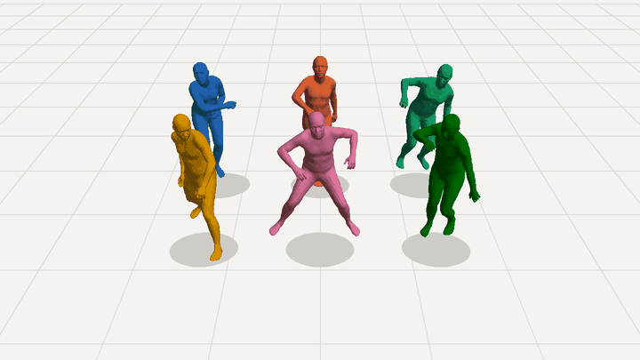

# DanceDiffuser

Generation of 3D human dance motion with a Diffusion Forcing transformer. Each frame is a body pose
in the MHR (Momentum Human Rig) parameter space, estimated from dance videos with SAM 3D Body.



*Six of the 100 one-minute dances generated by the current model that pass the glitch filter
(first 100 generated frames). A full one-minute dance is in [media/generated_dance.mp4](media/generated_dance.mp4).*

## Method

- **Data.** SAM 3D Body is run on every video frame (AIST Dance Database and multi-dancer videos).
  Dancers are tracked frame to frame from their 3D position, so each dancer becomes one sequence;
  missed detections (up to 3 frames) are interpolated.
- **Representation.** The model learns the first 136 of the 204 MHR model parameters (pose and
  motion), standardized per feature. Shape, expression and the remaining parameters are held fixed.
- **Model.** DiT with per-frame adaLN-Zero conditioning on the noise level, RoPE and QK-norm,
  predicting the clean frames (x0).
- **Training.** Diffusion Forcing: an independent noise level per frame, plus windows with a shared
  noise level and windows with a clean prefix. Cosine schedule (1000 steps), Min-SNR weighting
  `w = clamp(SNR, 1, 5)`, EMA weights.
- **Generation.** Autoregressive sliding window: a first window is generated from noise, then each
  pass keeps the last 16 frames as context and generates the next 16 (DDIM, 50 steps). The context
  can be noised (`--context-t`) and history guidance (`--guidance`) mixes the predictions with and
  without context.

## Current model (run `full_v1`)

| | |
|---|---|
| Data | 224 videos, 1,270 tracked sequences, 321,679 frames |
| Split | 1,199 sequences / 280,948 frames train, 71 sequences / 40,731 frames validation (held-out choreographies) |
| Model | DiT, 8 layers, width 384, 6 heads, 21.9M parameters, windows of 32 frames |
| Training | 100k steps, batch 256, AdamW 3e-4, bf16, 1 h 14 min on an RTX 5070 Ti |

## Usage

```bash
uv sync                                                    # training environment (PyTorch CUDA 12.8)
uv run python utils/create_sequences.py                    # dataset/data/<video>/frame_*.npz -> dataset/latent/*.npz
uv run python models/train.py --run-name full_v1 --val-fraction 0.05 --window 32 --context 16 \
    --hidden 384 --depth 8 --heads 6 --batch-size 256 --steps 100000 --eval-every 2500
uv run python models/sample.py runs/full_v1/checkpoints/last.pt --n 100 --frames 600 \
    --context 16 --context-t 400 --guidance 0.5 --run my_samples
```

Dashboard (training curves and 3D samples of every evaluation, http://localhost:8000), glitch filter
and video rendering use a separate environment with MHR. They need the
[MHR](https://github.com/facebookresearch/MHR) repository in `MHR/` with its assets in `MHR/assets`.

```bash
uv run --project dashboard python dashboard/server.py
uv run --project dashboard python dashboard/filter_glitches.py my_samples
uv run --project dashboard --with imageio-ffmpeg python dashboard/render.py runs/my_samples/samples/step_0100000/sample_0.npz -o dance.mp4
```

## Repository

| Path | Content |
|---|---|
| `models/DiT.py` | Diffusion transformer |
| `models/diffusion.py` | Noise schedule, Diffusion Forcing loss, DDIM, autoregressive generation |
| `models/train.py`, `models/sample.py` | Training and generation |
| `models/dataset.py` | Sequence loading, normalization, window sampling |
| `utils/create_sequences.py` | Per-frame SAM 3D Body outputs to tracked sequences |
| `dashboard/` | Training dashboard, glitch filter, renderer |

## References

- Chen et al., Diffusion Forcing: Next-token Prediction Meets Full-Sequence Diffusion, 2024. https://arxiv.org/abs/2407.01392
- Song et al., History-Guided Video Diffusion, 2025. https://arxiv.org/abs/2502.06764
- Peebles and Xie, Scalable Diffusion Models with Transformers, 2023. https://arxiv.org/abs/2212.09748
- Hang et al., Efficient Diffusion Training via Min-SNR Weighting Strategy, 2023. https://arxiv.org/abs/2303.09556
- Song et al., Denoising Diffusion Implicit Models, 2021. https://arxiv.org/abs/2010.02502
- SAM 3D Body: Robust Full-Body Human Mesh Recovery. https://arxiv.org/abs/2602.15989
- MHR: Momentum Human Rig. https://arxiv.org/abs/2511.15586
